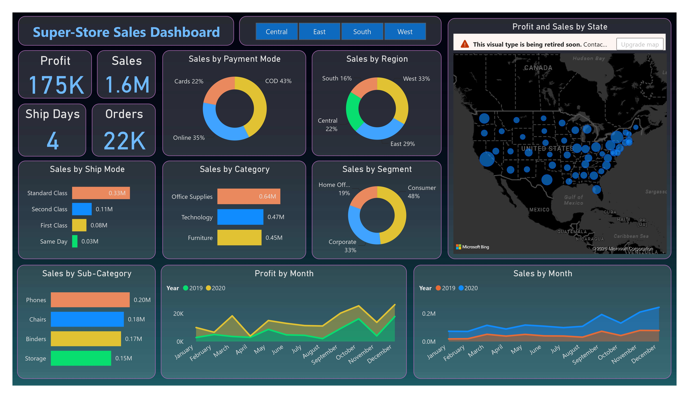
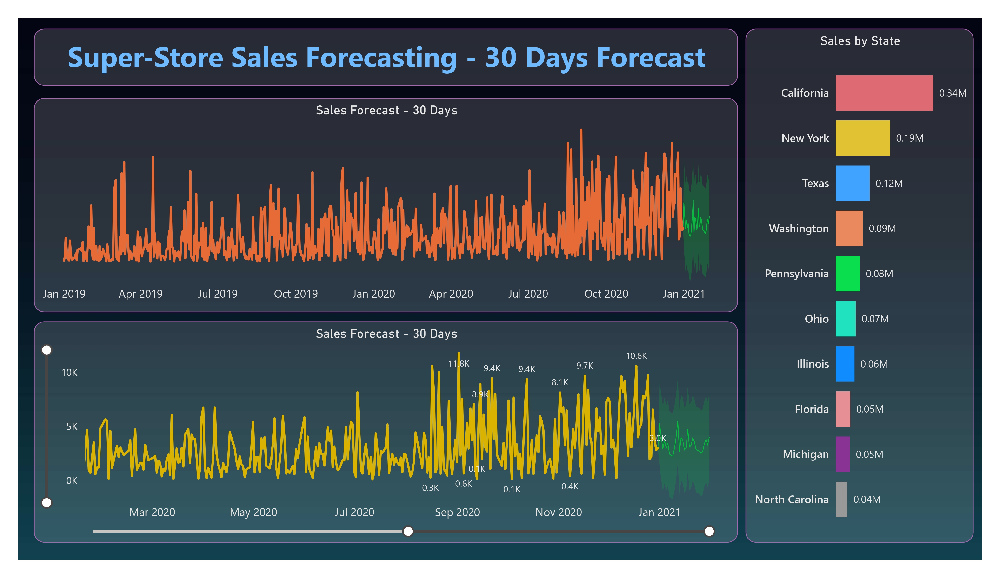

<div align="center">

# 🛒 SuperStore Sales Report — Power BI Dashboard

### Interactive retail performance analysis & 30-day sales forecasting built on the Sample Superstore dataset


</div>

---

## 🖥️ Dashboard Pages

### Page 1 · Executive Sales Dashboard



### Page 2 · 30-Day Sales Forecast



📄 **No Power BI installed?** [Open the exported PDF report](dashboard/Super-Store%20Sales%20Dashboard.pdf) for a static walkthrough of both pages.

---

## 🎯 The Business Problem

SuperStore's leadership needed one consistent, interactive source of truth to answer:

1. **Where are revenue and profit actually coming from?** — region, state, category, sub-category, segment, payment mode, ship mode
2. **How is the business trending?** — month-over-month and year-over-year (2019 vs 2020)
3. **Where is sales heading in the next 30 days?** — forecasting to support inventory and campaign planning

Before this report, answers lived in scattered Excel sheets with no shared KPI definitions.

---

## 📊 Page 1 — Executive Sales Dashboard: What It Contains

| Component | What It Shows |
|---|---|
| **Region slicer (buttons)** | Central / East / South / West — filters every visual on the page |
| **KPI cards** | Sales **1.6M** · Profit **175K** (≈ **10.9% margin**) · Orders **22K** · Avg Ship Days **4** |
| **Sales by Payment Mode** | COD **43%** · Online **35%** · Cards **22%** |
| **Sales by Region** | West **33%** · East **29%** · Central **22%** · South **16%** |
| **Profit & Sales by State (map)** | Geographic concentration of revenue across the US |
| **Sales by Ship Mode** | Standard Class **0.33M** dominates; Same Day smallest at 0.03M |
| **Sales by Category** | Office Supplies **0.64M** · Technology **0.47M** · Furniture **0.45M** |
| **Sales by Segment** | Consumer **48%** · Corporate **33%** · Home Office **19%** |
| **Sales by Sub-Category** | Phones **0.20M** · Chairs **0.18M** · Binders **0.17M** · Storage **0.15M** |
| **Profit by Month (2019 vs 2020)** | Year-over-year profitability trend with clear H2 acceleration |
| **Sales by Month (2019 vs 2020)** | 2020 consistently outperforms 2019 across all months |

---

## 🔮 Page 2 — 30-Day Sales Forecast: What It Contains

| Component | What It Shows |
|---|---|
| **Sales Forecast – 30 Days (full history)** | Daily sales from Jan 2019 → Jan 2021 with the 30-day forecast band (shaded confidence interval) |
| **Sales Forecast – 30 Days (zoom + slider)** | Interactive zoomed view with data labels and a time slider for inspecting recent peaks (e.g., 11.8K, 10.6K spikes) |
| **Sales by State** | California **0.34M** · New York **0.19M** · Texas **0.12M** · Washington **0.09M** · Pennsylvania **0.08M** and beyond |

**Forecast method:** Power BI's built-in **Analytics pane → Forecast** (exponential smoothing) applied to the daily sales series, with a 30-day horizon and confidence band — no external tooling required, fully reproducible inside the `.pbix`.

---

## 🔍 Key Insights Embedded in the Report

- **Profit margin sits at ≈ 10.9%** (175K profit on 1.6M sales) — healthy overall, but category-level drill-down is where margin risk hides.
- **COD is the #1 payment mode (43%)**, ahead of Online (35%) and Cards (22%) — unusual for e-commerce and worth a payment-strategy review.
- **The West region (33%) and California (0.34M) carry the business** — revenue is geographically concentrated, which is both a strength and a risk.
- **Consumer is the largest segment (48%)**, but Corporate (33%) is close behind — two very different buying behaviours needing separate marketing plans.
- **Standard Class shipping dominates (0.33M of ~0.55M)** — customers accept slower delivery, so premium shipping is not a revenue driver.
- **2020 outperformed 2019 in every month** for both sales and profit, with a strong Q4 — the forecast band builds on this upward seasonal pattern.

---

## 🧮 Core DAX Measures

All KPI cards are explicit measures, so every visual shares one consistent definition:

```dax
Total Sales   = SUM ( SuperStore[Sales] )

Total Profit  = SUM ( SuperStore[Profit] )

Profit Margin % = DIVIDE ( [Total Profit], [Total Sales] )

Total Orders  = DISTINCTCOUNT ( SuperStore[Order ID] )

Avg Ship Days =
AVERAGE (
    DATEDIFF ( SuperStore[Order Date], SuperStore[Ship Date], DAY )
)
```

Time comparisons (2019 vs 2020) use a marked Date table joined on `Order Date` with `SAMEPERIODLASTYEAR`-style time intelligence.

---

## 📁 Repository Structure

```text
SuperStore_Sales_Report-PowerBI/
│
├── README.md
│
├── data/
│   └── SuperStore_Sales_Dataset.csv        # Source dataset (order-line level)
│
└── dashboard/
    ├── Super-Store Sales Dashboard.pbix    # Interactive report (2 pages)
    ├── Super-Store Sales Dashboard.pdf     # Static export for quick viewing
    └── assets/
        ├── dashboard_overview.png          # Page 1 screenshot
        └── forecast_page.png               # Page 2 screenshot
```

---

## 📖 Data Dictionary

| Column | Description |
|---|---|
| `Order ID` | Unique order identifier |
| `Order Date` / `Ship Date` | Order placement and shipment dates |
| `Ship Mode` | Standard Class, Second Class, First Class, Same Day |
| `Customer ID` / `Customer Name` | Unique customer identifier and name |
| `Segment` | Consumer, Corporate, Home Office |
| `Country` / `City` / `State` / `Postal Code` / `Region` | Geography hierarchy (Region: Central, East, South, West) |
| `Category` / `Sub-Category` / `Product ID` / `Product Name` | Product hierarchy |
| `Sales` | Revenue for the order line |
| `Quantity` | Units sold |
| `Discount` | Discount rate applied |
| `Profit` | Profit for the order line |

---

## 🛠️ Tools & Technologies

- **Power BI Desktop** — data modelling, DAX measures, report design, forecasting
- **DAX** — explicit KPI measures and time intelligence
- **Power Query** — type conversion, column trimming, date preparation
- **Excel** — initial raw-data profiling

---

## 💻 How to Open the Report

1. Install [Power BI Desktop](https://powerbi.microsoft.com/desktop/) (free).
2. Clone or download this repository.
3. Open `dashboard/Super-Store Sales Dashboard.pbix`.
4. If prompted for the data source, point it to `data/SuperStore_Sales_Dataset.csv` and refresh.

No credentials, gateway, or external service required.

---

## ⚠️ Notes & Limitations

- The **map visual currently shows a retirement warning** in Power BI Desktop; a future revision will migrate it to the Azure Maps / Shape Map visual.
- The forecast is **univariate exponential smoothing** on daily sales; a production system would compare against ARIMA/Prophet baselines and include promotional calendars.
- The Sample Superstore dataset is a demo dataset — findings illustrate methodology, not real commercial results.

---

## 👤 Author

**Jatin Naresh Dolas**
Data Analyst | SQL · Python · Power BI · Streamlit

[](https://github.com/JatinD18)
[](https://www.linkedin.com/in/jatin-dolas)
